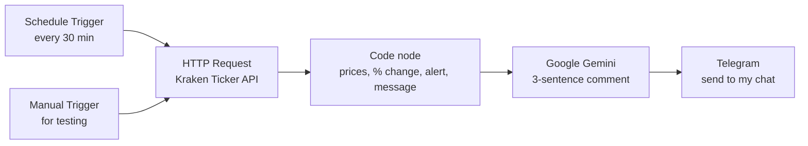

# Crypto Market Monitor (n8n + Kraken + Gemini + Telegram)

A small automation I built to learn n8n. Every 30 minutes it pulls the current Bitcoin and Ethereum prices in EUR from Kraken, works out how much they moved, asks Gemini to write a short plain-English comment, and sends the whole thing to my phone on Telegram. If a coin moves 1% or more between two updates, the message gets a 🚨 at the top.

I wanted something with live data so I could actually watch it run and debug it, instead of waiting a day for the next result.


## How it works



1. **Schedule Trigger** fires every 30 minutes (Berlin time, set in docker-compose).
2. **HTTP Request** calls `https://api.kraken.com/0/public/Ticker?pair=XBTEUR,ETHEUR`. It's a public endpoint, so no key or account is needed.
3. **Code node (JavaScript)** takes Kraken's raw response and calculates:
   - the last price,
   - the change since today's open (Kraken's day starts at 00:00 UTC),
   - the 24h high/low range,
   - the change since the previous run.
   The previous prices are stored with `$getWorkflowStaticData`, so the workflow remembers them between runs without needing a database. If either coin moved ≥ 1% since the last update, it flags an alert. It also builds the message text.
4. **Google Gemini** gets the numbers as JSON and writes at most three sentences about them. The prompt tells it to stick to the data, with no advice and no predictions.
5. **Telegram** sends the formatted message and the AI comment to my chat.

## Repo contents

```
docker-compose.yml               runs n8n locally in Docker
workflow/crypto-market-monitor.json   exported n8n workflow
images/                          screenshots
```

## Running it yourself

You need Docker Desktop, a Telegram bot token (from @BotFather), your Telegram chat ID, and a Gemini API key from Google AI Studio.

```bash
docker compose up -d
```

Then:

1. Open http://localhost:5678 and create the owner account.
2. Import `workflow/crypto-market-monitor.json` (Workflows → Import from file).
3. Create two credentials in n8n: **Telegram** (bot token) and **Google Gemini** (API key).
4. In the Telegram node, replace `YOUR_TELEGRAM_CHAT_ID` with your chat ID.
5. Click **Execute workflow** to test it, then **Publish**/activate it so the schedule runs.

No secrets are stored in this repo. n8n keeps credentials encrypted in its own database, and the workflow export only references them by name.

## Why I set it up this way

- **Self-hosted n8n in Docker instead of n8n Cloud.** Cloud is a 14-day trial and then a paid plan with a monthly execution limit. 48 runs a day adds up quickly. Self-hosted Community Edition is free with no execution limit, and the same compose file could go onto a small server later.
- **Kraken instead of CoinGecko.** Kraken's public market data needs no API key, it has EUR pairs, and its rate limit is far above what one request every 30 minutes needs.
- **Gemini free tier.** No credit card, and a Flash-Lite model is more than enough for three sentences. Billing is deliberately not enabled on the Google project. If the free quota runs out, the call just fails; it can't turn into a bill.
- **Static data instead of a database** for "change since last run". It's only two numbers, so a database would have been overkill.

## Things that tripped me up

- **Node names in expressions.** `$('Code')` failed because newer n8n names the node "Code in JavaScript". Expressions reference nodes by their exact title, so I renamed the node.
- **Static data only persists in scheduled runs.** When you click *Execute workflow* manually, n8n doesn't save `$getWorkflowStaticData`, so manual tests always show "first run". To test the alert, I set the threshold to 0.01% and the interval to 2 minutes, waited for two scheduled runs, then set both back.
- **Kraken's naming.** Bitcoin is `XBT`, and the response keys have legacy prefixes (`XXBTZEUR`, `XETHZEUR`). Field `c[0]` is the last price, `o` the daily open, and `h[1]`/`l[1]` the 24h high/low.
- **Timezone.** Without `GENERIC_TIMEZONE=Europe/Berlin` in docker-compose, the schedule and timestamps would be in UTC.
- **Short intervals and free quotas.** I briefly ran it every 5 minutes for testing. That's fine for Kraken, but it would use up a free Gemini daily quota fast, so I went back to 30 minutes.

## Limitations

- It runs on my laptop, so it only sends messages while the laptop is awake and Docker Desktop is running. For 24/7 use I'd move the container to a small VPS.
- The alert compares only against the previous run, not a rolling window.
- Market data only. It doesn't trade and doesn't give advice.

## Ideas for later

- Log every run to a Google Sheet or Postgres and plot the history.
- A separate daily summary at 18:00 instead of Gemini on every update.
- An error workflow that pings me on Telegram if Kraken or Gemini fails.
- A second workflow for the ECB's daily EUR/USD rate and deposit rate (builds on my Project 4).

## Costs

€0. n8n Community Edition, the Kraken public API, the Telegram Bot API and the Gemini free tier are all free at this usage.
